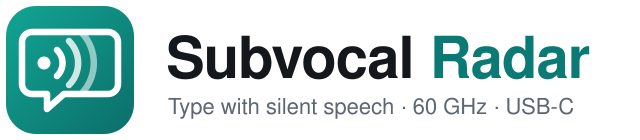
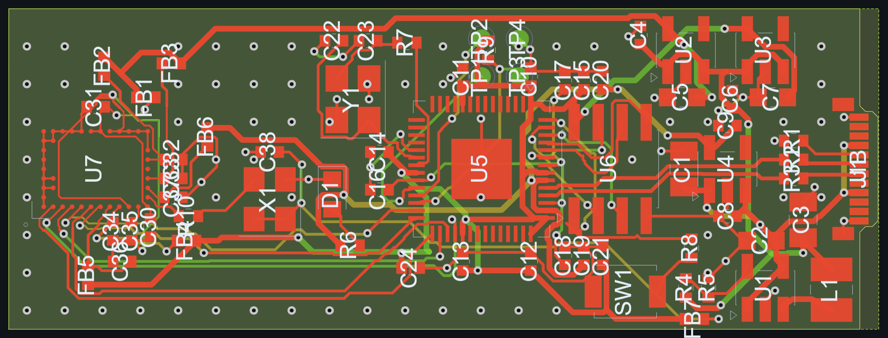
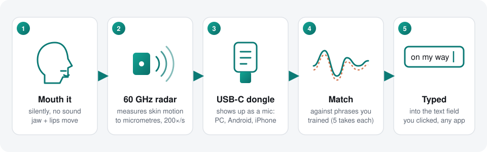
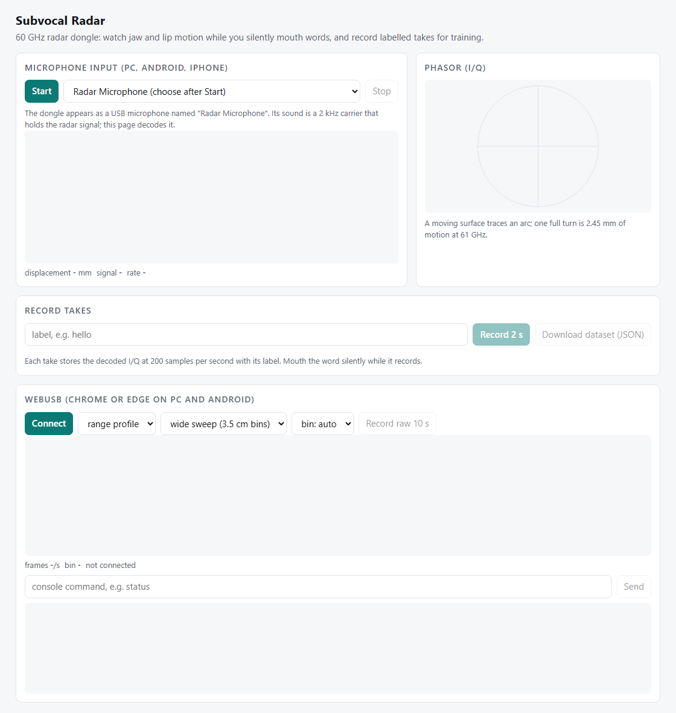
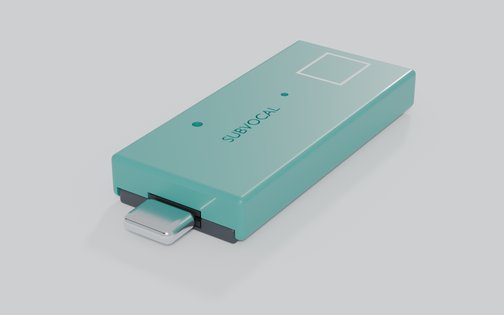
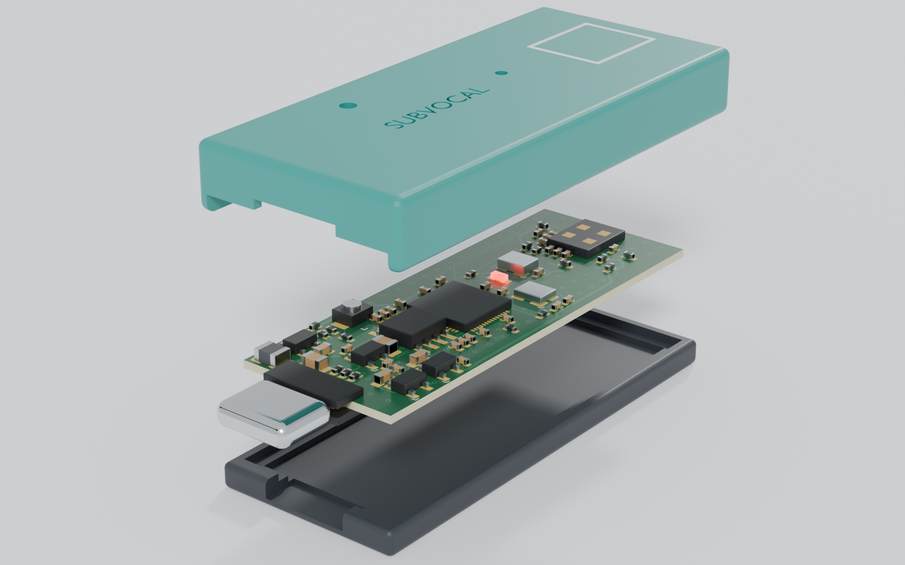

<p align="center">
  <picture>
    <source media="(prefers-color-scheme: dark)" srcset="docs/assets/logo-dark.svg">
    
  </picture>
</p>

<p align="center">
  <b>Talk to your computer without making a sound.</b><br>
  A 60 GHz radar on a USB-C dongle reads the tiny jaw and lip movements of silent speech,<br>
  and types the phrase you mouthed into any text field, on Windows and Android.
</p>

<p align="center">
  
  
  
  
  
</p>

<p align="center">
  
</p>

---

## What it is

Inspired by [The Subvocal Company](https://www.ycombinator.com/companies/the-subvocal-company) (YC F26), whose glasses read silent speech with radio waves. Subvocal Radar is an independent, buildable version of that idea:

- **Hardware**: a 17 × 46 mm USB-C dongle with an Infineon BGT60TR13C radar (1 Tx, 3 Rx, antennas in the package) and an RP2040. Ready to order from JLCPCB, fully assembled.
- **Firmware**: turns radar frames into a skin-motion signal and sends it over USB as a **microphone**, a **WebUSB stream** and a **serial console**. No drivers on any OS.
- **Apps**: hold a key (Windows) or a floating bubble (Android), silently mouth a phrase you trained, and it is typed where your cursor is.

<p align="center">
  
</p>

## Highlights

| | |
|---|---|
| 🎯 **Micrometre motion** | The radar's phase follows skin displacement at 0.39 mm per radian, 200 times a second. A 58.6-63.2 GHz sweep gives ~3.5 cm range bins, so the dongle locks onto your jaw and ignores the room. |
| 🔌 **Works everywhere** | The dongle is a standard USB microphone: PC, Mac, Linux, Android and iPhone record it with no driver. The radar signal rides on a 2 kHz carrier, so phone audio processing cannot damage it. |
| ⌨️ **Types into any app** | Windows: hold **F8**, mouth, release; the text is pasted where your cursor is. Android: hold the bubble; an accessibility service types into the focused field. |
| 🧠 **Your own vocabulary** | Train each phrase with ~5 takes. Matching uses dynamic time warping, tolerant of faster or slower mouthing. Phrases move between PC and phone as one file. |
| 🏭 **Order it assembled** | Gerbers, BOM with LCSC part numbers and placement file for JLCPCB's Economic assembly, plus a [step-by-step order guide](hardware/jlcpcb/ORDER.md). |
| 🔁 **Fully scripted** | Schematic, footprint, placement, routing, DRC and fab outputs are regenerated by scripts with [openpcb](https://github.com/ajisrawi/openpcb). |

## Quick start

**1. Order the board.** Upload the three files from [`hardware/jlcpcb/`](hardware/jlcpcb/) to JLCPCB and pick the options in [ORDER.md](hardware/jlcpcb/ORDER.md): 4 layers, **0.8 mm** thick (the USB-C plug needs it), ENIG, Economic PCBA, top side.

**2. Install the firmware.** Plug the dongle into a computer; a drive called **RPI-RP2** appears. Copy [`firmware/release/subvocal_radar.uf2`](firmware/release/) onto it. Details: [docs/FLASHING.md](docs/FLASHING.md).

**3. Install an app.**

| Windows | Android | Any browser (PC, Android, iPhone) |
|---|---|---|
| [`apps/dist/windows/Subvocal.exe`](apps/dist/windows/) (.NET 6 Desktop Runtime) | [`apps/dist/Subvocal-android.apk`](apps/dist/) (Android 8+) | [`host/index.html`](host/), serve it locally with `npx serve host` |

**4. Train and type.** Add a phrase such as `on my way`, record it 5 times, then click into any text field, hold **F8** or the bubble, mouth it silently and let go. Guide: [apps/README.md](apps/README.md).

<p align="center">
  
</p>

## Hardware

| Part | Choice | Why |
|---|---|---|
| Radar | Infineon BGT60TR13C (LCSC C3606641) | 60 GHz FMCW, 3 receivers, antennas in a 6.5 × 5 mm package |
| MCU | Raspberry Pi RP2040 (C2040), I/O at **1.8 V** | The radar's SPI pins are 1.8 V only (2.0 V absolute max) |
| Flash | Winbond W25Q16JWSNIQ (C7117004) | 1.8 V QSPI, 2 MB |
| Radar clock | TXC 7X80000600 (C5203597) | 80 MHz, 1.8 V CMOS reference |
| Power | TLV62569 buck → 2 × TPS7A2018 (7 µVrms) + TPS7A2033 | Radar supplies must stay under 20 µVpp ripple |
| USB | Molex 105444 USB-C plug | Plugs straight into a phone or laptop |
| PCB | 4 layers, 0.8 mm, 17 × 46 mm, all parts on top | Solid ground plane under the radar, one-sided assembly |

Schematic: [PDF](hardware/subvocal-radar-schematic.pdf) · source [`hardware/subvocal-radar.opensch.json`](hardware/subvocal-radar.opensch.json). Board: [`hardware/subvocal-radar.openboard.json`](hardware/subvocal-radar.openboard.json). 3D model: [`hardware/fab/subvocal-radar.step`](hardware/fab/).

Rebuild everything from the scripts (needs Node.js, KiCad 10 for its footprint library, and [openpcb](https://github.com/ajisrawi/openpcb); set `OPENPCB_DIR` and `KICAD_FOOTPRINTS` if they are not in the default places):

```bash
node hardware/scripts/make_schematic.mjs        # schematic + LCSC part numbers
node hardware/scripts/make_bgt60_footprint.mjs  # radar BGA footprint from the datasheet ball map
node hardware/scripts/make_board.mjs            # place, route (OpenRoute), DRC, pour check, fab files
node hardware/scripts/make_jlc.mjs              # JLCPCB order package
```

## Enclosure

<p align="center">
  
  
</p>

A two-part 3D-printable case, 22.6 × 49.8 × 7.4 mm: a tray that holds the board and a lid that slides over it. The lid's top is half a wavelength thick at 60 GHz (1.47 mm of PLA) with a half-wavelength air gap above the radar, so the plastic is close to invisible to the radar. STL files, print settings and the Blender scene: [hardware/enclosure/](hardware/enclosure/).

## Video

A 90-second overview with voiceover: [media/video/subvocal-radar.mp4](media/video/subvocal-radar.mp4). It is generated from code (`media/video/make_video.py`).

## Firmware

RP2040 firmware on Pico SDK 2.3 and TinyUSB 0.18 ([`firmware/`](firmware/)). Core 1 reads radar frames (8 chirps × 64 samples × 3 receivers, 200 per second) and processes them; core 0 runs USB.

| USB interface | Use |
|---|---|
| **Radar Microphone** (UAC2, 16 kHz) | The motion signal for apps, browsers and phones |
| **Radar Stream** (WebUSB) | Range profiles or raw ADC frames for recording training data |
| **Radar Console** (serial) | `status`, `preset wide\|narrow`, `bin`, `stream`, `reg`, `boot` |

Build on Windows with `firmware\build.ps1`, or with CMake + Ninja anywhere ([docs/FLASHING.md](docs/FLASHING.md)).

## Repository

```
hardware/        schematic, board, footprints, build scripts
  jlcpcb/        Gerbers, BOM (LCSC numbers), CPL, ORDER.md
  fab/           raw fab outputs, STEP model
  enclosure/     3D-printable case (STL), Blender scene and renders
firmware/        RP2040 firmware, release/subvocal_radar.uf2
apps/            Subvocal for Windows and Android, decoder tests, dist/ builds
host/            web viewer and recorder (single HTML file)
docs/            firmware install guide, logo and images
media/video/     90-second overview video and the code that generates it
```

## Status

- ✅ Schematic passes ERC. Board fully routed, **0 DRC violations**, every pad connected through real copper (pour check).
- ✅ Firmware compiles (54 KB). Windows and Android apps build. The decoder recognises 95-99% of phrases in simulation, and the Kotlin port matches the C# decoder exactly.
- ⏳ **Not yet built or tested on real hardware.** Expect bring-up fixes once the first boards arrive.
- ℹ️ The apps recognise a **personal list of trained phrases**, not free-form sentences. Open-vocabulary silent speech needs a neural model trained on many hours of data; every take you record is saved in a format that can train one later.
- ℹ️ USB IDs are the pid.codes test pair (0x1209:0x0001), fine for development.
- ℹ️ 60 GHz radar at this power is allowed for this use in the US (FCC 15.255) and the EU (57-64 GHz SRD). Check your local rules.

## Rights

© 2026 ajisrawi. All rights reserved. No license is granted: you may view this repository, but copying, modifying or distributing it requires permission.

Third-party code keeps its own license: the radar register access in `firmware/src/bgt60.c` is ported from Infineon's [sensor-xensiv-bgt60trxx](https://github.com/Infineon/sensor-xensiv-bgt60trxx) (Apache-2.0), and the USB descriptors follow [TinyUSB](https://github.com/hathach/tinyusb) examples (MIT).

Not affiliated with or endorsed by The Subvocal Company, Infineon, Raspberry Pi or JLCPCB. Trademarks belong to their owners.
